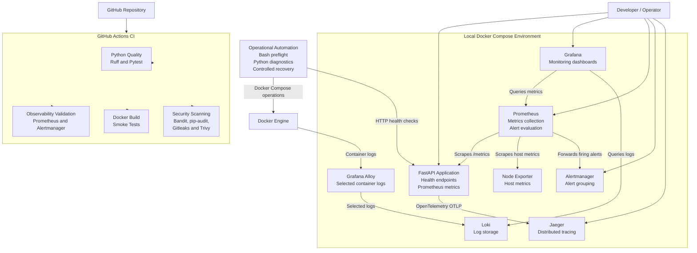

# OpsPulse — Linux & Container Reliability Automation Platform

[](https://github.com/GowthamThalluri/opspulse-reliability-lab/actions/workflows/ci.yml)

OpsPulse is a small, local-first DevOps and Site Reliability Engineering (SRE) project built to demonstrate practical container operations, observability, incident diagnostics, and controlled service recovery.

It takes a FastAPI application and builds a reliability workflow around it using Docker, Prometheus, Grafana, Loki, Jaeger, Python automation, and GitHub Actions.

The project focuses on one application and demonstrates how a DevOps engineer can monitor it, detect failures, investigate incidents, and verify service recovery.

## Architecture



## Project Features

### 1. FastAPI Application

- Lightweight Python FastAPI application.
- Application information endpoint.
- Liveness and readiness health endpoints.
- Prometheus metrics endpoint.
- HTTP request count and request duration metrics.
- OpenTelemetry instrumentation for distributed tracing.

### 2. Docker Containerization

- Custom Dockerfile for building the application image.
- Docker Compose for running the complete local environment.
- Non-root application user.
- Read-only container root filesystem.
- Linux capabilities dropped.
- `no-new-privileges` security option.
- Docker health check for the API.
- Temporary filesystem for writable runtime data.

### 3. Monitoring and Dashboards

- Prometheus collects application and host metrics.
- Grafana provides API and host monitoring dashboards.
- Node Exporter exposes system metrics.
- API availability, HTTP request rates, errors, and latency can be monitored.

**Windows environment note:** When running through Docker Desktop, Node Exporter reports CPU and memory metrics from the Docker Desktop Linux environment, not native Windows CPU and memory metrics. The Python diagnostics tool separately collects Windows operating system, architecture, and disk information.

### 4. Centralized Logging

- Grafana Alloy discovers Docker containers.
- Selected container logs are collected and forwarded to Loki.
- Grafana Explore provides an interface for querying and investigating logs.

### 5. Distributed Tracing

- OpenTelemetry instrumentation for FastAPI.
- Traces are exported to Jaeger using OTLP.
- API requests and readiness-check activity can be inspected through the Jaeger UI.

Jaeger uses in-memory storage in this project, so traces are not persistent across container recreation.

### 6. Alerting

Prometheus evaluates five alert rules:

| Alert | Purpose |
|---|---|
| `OpsPulseAPIDown` | Detects API availability failure |
| `OpsPulseHigh5xxErrorRate` | Detects a high HTTP 5xx error rate |
| `OpsPulseHighP95Latency` | Detects high P95 request latency |
| `OpsPulseHostHighCPU` | Detects high host CPU utilization |
| `OpsPulseHostDiskSpaceLow` | Detects low disk space |

Alertmanager receives and groups firing alerts locally.

No external email, Slack, or other notification receiver is configured.

### 7. Operational Automation

- Bash preflight checks for Docker and application health.
- Python diagnostics collect container and host information.
- JSON incident diagnostic reports.
- Controlled API recovery with dry-run as the default.
- Post-recovery health verification.

### 8. DevSecOps and Continuous Integration

GitHub Actions validates repository changes through four jobs:

| CI Job | Responsibilities |
|---|---|
| Python Quality | Ruff, formatting checks, and Pytest |
| Observability Validation | Docker Compose, Prometheus, alert rules, and Alertmanager validation |
| Docker Build and Smoke Test | Builds the application image and validates runtime behavior |
| Security Scanning | Bandit, pip-audit, Gitleaks, and Trivy |

## Technology Stack

| Category | Technologies |
|---|---|
| Application | Python 3.13, FastAPI |
| Containerization | Docker, Docker Compose |
| Monitoring | Prometheus, Node Exporter |
| Dashboards | Grafana |
| Logging | Grafana Alloy, Loki |
| Distributed Tracing | OpenTelemetry, Jaeger |
| Alerting | Prometheus Alert Rules, Alertmanager |
| Automation | Bash, Python |
| Testing and Code Quality | Pytest, Ruff |
| Security | Bandit, pip-audit, Gitleaks, Trivy |
| CI/CD | GitHub Actions |

## Prerequisites

Install the following tools:

- Git
- Docker Desktop
- Docker Compose v2
- Python 3.13
- Git Bash (for the Windows commands in this guide)

Docker Desktop must be running before starting the application.

## Getting Started

### 1. Clone the repository

```bash
git clone https://github.com/GowthamThalluri/opspulse-reliability-lab.git

cd opspulse-reliability-lab
```

### 2. Create a Python virtual environment

The following commands use Git Bash on Windows.

```bash
python -m venv .venv

source .venv/Scripts/activate
```

Install the project and development dependencies:

```bash
python -m pip install -r requirements-dev.txt
```

### 3. Configure environment variables

Copy the example environment file:

```bash
cp .env.example .env
```

Edit `.env` and configure a unique value for:

```text
GRAFANA_ADMIN_PASSWORD
```

Do not commit `.env` or share its contents. It contains local credentials.

### 4. Validate Docker Compose configuration

```bash
docker compose config --quiet
```

The command should finish without configuration errors.

### 5. Build and start the services

```bash
docker compose up -d --build
```

### 6. Verify the running services

Check the service status:

```bash
docker compose ps
```

Check the API liveness endpoint:

```bash
curl -fsS http://localhost:8001/health/live
```

Check the API readiness endpoint:

```bash
curl -fsS http://localhost:8001/health/ready
```

Expected responses:

```json
{"status":"alive"}
{"status":"ready"}
```

## Accessing the Services

Once the Compose environment is running, access the services using the following local URLs.

| Service | URL |
|---|---|
| OpsPulse API | http://localhost:8001 |
| Prometheus | http://localhost:9090 |
| Grafana | http://localhost:3000 |
| Alertmanager | http://localhost:9093 |
| Jaeger | http://localhost:16686 |
| Grafana Alloy UI | http://localhost:12345 |

### Grafana Login

- Username: `admin`
- Password: The value configured in `GRAFANA_ADMIN_PASSWORD` in `.env`.

Use Grafana dashboards to monitor API and host metrics.

Use Grafana Explore to query Prometheus metrics and Loki logs.

## Application Endpoints

| Endpoint | Purpose |
|---|---|
| `/` | Application information |
| `/health/live` | Checks whether the API process is alive |
| `/health/ready` | Checks whether the API is ready |
| `/metrics` | Exposes application metrics for Prometheus |

## Operational Automation

OpsPulse includes Bash and Python tools for routine operational checks, incident diagnostics, and controlled service recovery.

### 1. Run preflight checks

Execute the Bash preflight script:

```bash
bash scripts/preflight.sh
```

The script checks:

- Docker CLI availability.
- Docker daemon connectivity.
- Docker Compose configuration validity.
- Running state of all eight required services.
- Docker health status where configured.
- API liveness and readiness endpoints.

**Health-check coverage:** Only the API currently has a Docker health check configured. The other seven services are checked for running state.

The script displays a summary of passed and failed checks and exits with a non-zero status when checks fail.

### 2. Collect incident diagnostics

Run the Python diagnostics tool:

```bash
python -m automation.collect_diagnostics
```

The tool collects:

- Docker Compose service status.
- API health-check results.
- Host operating system information.
- Host architecture and disk information.
- Overall operational status.

A JSON incident report is saved under the local `reports/` directory.

Generated reports are excluded from Git.

### 3. Perform controlled service recovery

Start with the default dry-run mode:

```bash
python -m automation.recover_service --service api
```

Dry-run mode checks whether the API is eligible for recovery without restarting the container.

To perform an actual restart when the API container is running but Docker reports its health as unhealthy:

```bash
python -m automation.recover_service --service api --apply
```

After attempting recovery, the tool verifies Docker health and API endpoints.

Recovery is restricted to the approved API service. Stopped containers are not eligible for this recovery operation.

## Incident Demonstration: API Outage and Recovery

This exercise demonstrates how OpsPulse detects an application outage, collects diagnostics, restores the service, and verifies recovery.

### Step 1: Simulate an API outage

Stop the API container:

```bash
docker compose stop api
```

### Step 2: Observe the alert

Wait approximately 90 seconds for the Prometheus alert rule to fire.

Open the following interfaces:

- Prometheus Alerts: http://localhost:9090/alerts
- Alertmanager: http://localhost:9093

Verify that `OpsPulseAPIDown` fires in Prometheus and reaches Alertmanager.

### Step 3: Collect incident diagnostics

While the API is stopped, run:

```bash
python -m automation.collect_diagnostics
```

Inspect the generated JSON report under `reports/`.

The API should be reported as unhealthy because the container is stopped and the health endpoints are unavailable.

### Step 4: Restore the API

Start the API container:

```bash
docker compose start api
```

Verify the API:

```bash
curl -fsS http://localhost:8001/health/live

curl -fsS http://localhost:8001/health/ready
```

Both endpoints should return HTTP 200.

### Step 5: Verify alert resolution

Allow the next Prometheus evaluation cycle to complete.

Check Prometheus and Alertmanager again. The `OpsPulseAPIDown` alert should no longer be firing.

This demonstration covers:

1. Incident simulation.
2. Monitoring and alert detection.
3. Incident diagnostics.
4. Service restoration.
5. Post-recovery verification.

**Note:** This incident demonstration restores a stopped API container using Docker Compose. The separate Python recovery tool handles a running API container that reports an unhealthy Docker health status.

## Running Tests

Activate the virtual environment before running the following commands.

### Run automated tests

```bash
python -m pytest -v
```

### Run code quality checks

```bash
ruff check .

ruff format --check .
```

### Run security checks

```bash
bandit -r app automation -ll

pip-audit -r requirements-dev.txt
```

### Validate the Bash script

```bash
bash -n scripts/preflight.sh
```

### Validate Docker Compose configuration

```bash
docker compose config --quiet
```

## Stopping the Project

To stop and remove the Compose containers and network:

```bash
docker compose down
```

This preserves the named Docker volumes containing persistent service data.

Do not use `docker compose down -v` unless you intentionally want to remove the persistent volumes.

## Project Scope and Limitations

OpsPulse is designed as a compact, local-first DevOps and reliability engineering project.

The project demonstrates:

- Containerization and Docker Compose operations.
- Application and host monitoring.
- Centralized logging and distributed tracing.
- Alerting and incident investigation.
- Bash and Python operational automation.
- Container security and vulnerability scanning.
- Automated CI validation through GitHub Actions.

It is not a production cloud deployment. It does not include Kubernetes orchestration, Terraform infrastructure provisioning, Ansible configuration management, or external alert notification integrations.

The focus is on demonstrating a complete, practical reliability workflow for one application without unnecessarily expanding the project.

---

**Repository:** [GowthamThalluri/opspulse-reliability-lab](https://github.com/GowthamThalluri/opspulse-reliability-lab)