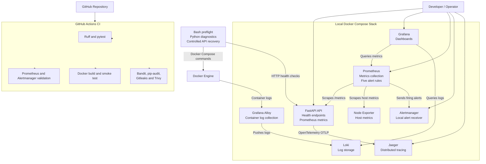

# OpsPulse — Linux & Container Reliability Automation Platform

OpsPulse is a small, local-first DevOps and SRE reliability project.

It demonstrates how to containerize an application, monitor its
health and performance, collect logs and traces, detect incidents,
and perform controlled service recovery.

## Architecture




## Project Features

### 1. FastAPI Application
- Lightweight FastAPI application.
- Liveness and readiness health endpoints.
- Prometheus metrics endpoint.
- HTTP request count and request duration metrics.

### 2. Monitoring and Dashboards
- Prometheus collects application and host metrics.
- Grafana provides API and host monitoring dashboards.
- Node Exporter exposes system metrics.

### 3. Centralized Logging
- Grafana Alloy collects selected Docker container logs.
- Loki stores and indexes the logs.
- Logs can be explored through Grafana.

### 4. Distributed Tracing
- OpenTelemetry instrumentation for FastAPI.
- Traces are exported to Jaeger.
- Request and readiness-check activity can be inspected.

### 5. Alerting
Prometheus evaluates five alert rules:
- API availability.
- High HTTP 5xx error rate.
- High P95 response latency.
- High host CPU utilization.
- Low disk space.

Alertmanager receives and groups firing alerts locally.

### 6. Operational Automation
- Bash preflight checks for Docker and application health.
- Python diagnostics collect service and host information.
- Controlled API recovery with dry-run as the default.
- JSON incident diagnostic reports.

### 7. DevSecOps and CI
GitHub Actions automatically validates changes through four jobs:
- Python quality checks and automated tests.
- Prometheus and Alertmanager configuration validation.
- Docker image build and smoke tests.
- Security scanning using Bandit, pip-audit, Gitleaks and Trivy.


## Technology Stack

| Category | Technologies |
|---|---|
| Application | Python 3.13, FastAPI |
| Containerization | Docker, Docker Compose |
| Monitoring | Prometheus, Node Exporter |
| Dashboards | Grafana |
| Logging | Grafana Alloy, Loki |
| Distributed Tracing | OpenTelemetry, Jaeger |
| Alerting | Prometheus Alert Rules, Alertmanager |
| Automation | Bash, Python |
| Testing and Quality | Pytest, Ruff |
| Security | Bandit, pip-audit, Gitleaks, Trivy |
| CI/CD | GitHub Actions |


## Prerequisites

- Git
- Docker Desktop
- Docker Compose v2
- Python 3.13 (for local development and tests)
- Git Bash (for Bash automation scripts on Windows)

Docker Desktop must be running before starting the application.

## Getting Started

### 1. Clone the repository

```bash
git clone https://github.com/GowthamThalluri/opspulse-reliability-lab.git

cd opspulse-reliability-lab
```

### 2. Configure environment variables

Copy the example environment file:

```bash
cp .env.example .env
```

Edit `.env` and set a unique value for `GRAFANA_ADMIN_PASSWORD`.

Do not commit `.env` or share its contents. It contains local credentials.

### 3. Validate the Docker Compose configuration

```bash
docker compose config --quiet
```

### 4. Build and start the services

```bash
docker compose up -d --build
```

### 5. Verify the running services

```bash
docker compose ps
```

Check API health:

```bash
curl http://localhost:8001/health/live
curl http://localhost:8001/health/ready
```

Expected responses:

```json
{"status":"alive"}
{"status":"ready"}
```

## Accessing the Services

| Service | Local URL |
|---|---|
| OpsPulse API | http://localhost:8001 |
| Prometheus | http://localhost:9090 |
| Grafana | http://localhost:3000 |
| Alertmanager | http://localhost:9093 |
| Jaeger | http://localhost:16686 |
| Grafana Alloy | http://localhost:12345 |

Grafana login:
- Username: `admin`
- Password: Value configured in `GRAFANA_ADMIN_PASSWORD` in `.env`

Use Grafana Explore to query Loki logs and Prometheus metrics.

## Application Endpoints

| Endpoint | Purpose |
|---|---|
| `/` | Application information |
| `/health/live` | Liveness check |
| `/health/ready` | Readiness check |
| `/metrics` | Prometheus metrics |

## Stopping the Project

```bash
docker compose down
```

This stops and removes the Compose containers and network while retaining named volumes.

## Operational Automation

OpsPulse includes Bash and Python tools for operational checks,
incident diagnostics, and controlled service recovery.

### 1. Preflight Checks

Run the Bash preflight script:

```bash
bash scripts/preflight.sh
```

It checks:
- Docker CLI and daemon availability.
- Docker Compose configuration.
- Running state of all eight required services.
- Docker health status where configured.
- API liveness and readiness endpoints.

The script exits with a non-zero status when checks fail.

### 2. Collect Incident Diagnostics

Run:

```bash
python -m automation.collect_diagnostics
```

The diagnostics tool collects:
- Docker Compose service status.
- API health-check results.
- Host operating system and disk information.
- Overall operational status.

A JSON incident report is saved under the local `reports/` directory.
These generated reports are not committed to Git.

### 3. Controlled Service Recovery

First, run the recovery tool in its default dry-run mode:

```bash
python -m automation.recover_service --service api
```

Dry-run mode checks whether the API is eligible for recovery
without restarting the container.

To perform an actual restart when the API is running but Docker
reports its health as unhealthy:

```bash
python -m automation.recover_service --service api --apply
```

The recovery tool verifies Docker health and API endpoints after
attempting recovery.

Recovery is restricted to the approved API service.


## Incident Demonstration: API Outage and Recovery

This exercise demonstrates how OpsPulse detects an application
outage, collects diagnostics, and verifies service recovery.

### 1. Simulate an API outage

Stop the API container:

```bash
docker compose stop api
```

### 2. Observe the alert

Wait approximately 90 seconds for the Prometheus alert rule to fire.

Open:

- Prometheus Alerts: http://localhost:9090/alerts
- Alertmanager: http://localhost:9093

Verify that `OpsPulseAPIDown` fires and reaches Alertmanager.

### 3. Collect incident diagnostics

Run:

```bash
python -m automation.collect_diagnostics
```

Inspect the generated JSON report under `reports/`.

The API should be reported as unhealthy while it is stopped.

### 4. Restore the API

Start the API container:

```bash
docker compose start api
```

Verify recovery:

```bash
curl -fsS http://localhost:8001/health/live
curl -fsS http://localhost:8001/health/ready
```

Expected: both endpoints return HTTP 200.

### 5. Verify alert resolution

Check Prometheus and Alertmanager again after the next evaluation cycle.

The API-down alert should no longer be firing.

This exercise demonstrates incident detection, diagnostics,
service recovery, and post-recovery verification.
